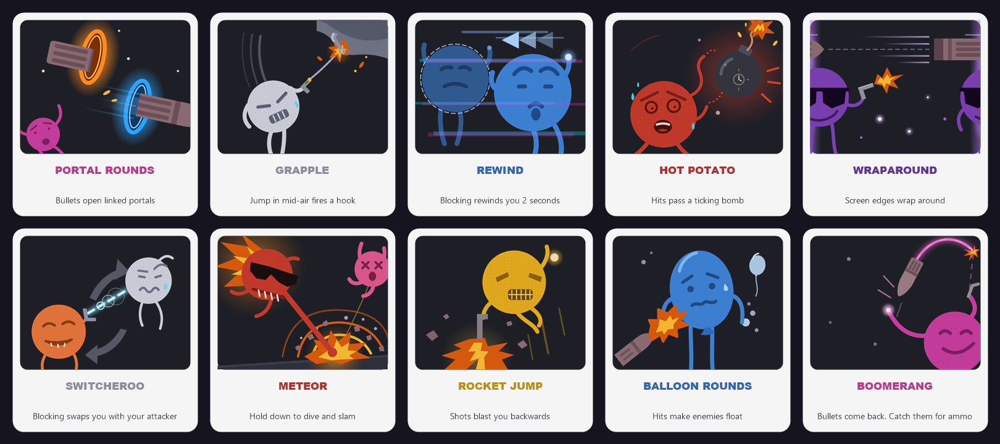

# WildCards — a ROUNDS card mod



10 cards for [ROUNDS](https://store.steampowered.com/app/1557740/ROUNDS/), each built around a new action rather than a stat change.

| Card | What it does |
|---|---|
| PORTAL ROUNDS | Your bullets open an orange and a blue portal where they hit walls. Players and bullets travel through them, enemies included. |
| GRAPPLE | Jump in mid-air with no jumps left to fire a hook. Hold jump to swing and reel in, let go to fling. Hooking a player yanks them toward you. |
| REWIND | A ghost of you trails 2s behind, visible to everyone. Blocking snaps you back to it. |
| HOT POTATO | Your hit plants a 5s bomb. The holder passes it by shooting or touching someone. It explodes on whoever holds it at the end. |
| WRAPAROUND | You and your bullets wrap around the screen edges. Fall off the bottom and you drop in from the top. |
| SWITCHEROO | Blocking swaps places with whoever hurt you in the last 5s. |
| METEOR | Hold down in the air to dive. Landing sends out a shockwave that damages and launches nearby enemies. |
| ROCKET JUMP | Shooting pushes you away from your aim. Shoot the floor to fly. |
| BALLOON ROUNDS | Hits pop enemies upward and make them float briefly. |
| BOOMERANG | Bullets turn around at walls (or after a moment) and fly back to you through terrain, +30% damage. Catch them to get the ammo back. |

## Install (players)
1. Install [r2modman](https://thunderstore.io/package/ebkr/r2modman/) and create a ROUNDS profile with **UnboundLib** (it pulls in BepInEx and MMHook).
2. Download `WildCards-<version>.zip` from Releases, then in r2modman go to **Settings → Import local mod** and pick the zip.
3. Launch modded. Everyone in the lobby needs the same version.

Config `BepInEx/config/com.wildcards.rounds.cards.cfg` → `WildCardChance` (default 0.6) is the chance that each offered card is replaced by a WildCards card. Set it to 0 for normal odds.

## Build (developers)
Windows, Git Bash. No .NET SDK is needed: `build.sh` uses the .NET Framework `csc.exe` built into Windows (**C# 5 only**).

```bash
# Optional overrides (defaults: Steam install + r2modman profile "WildCards 1v1")
export ROUNDS_MANAGED='C:\...\ROUNDS\ROUNDS_Data\Managed'
export BEPINEX_DIR='C:\...\r2modmanPlus-local\ROUNDS\profiles\<profile>\BepInEx'
bash build.sh                  # -> bin/WildCards.dll + bin/WildCards-<version>.zip
CARD=Portal bash build.sh      # compile check with only src/Cards/New/Portal.cs among the new cards
powershell -File install.ps1 -Profile "WildCards 1v1"   # copy the build into an r2modman profile
```

- `src/` — plugin, shared helpers (`Common.cs`), Harmony hook points (`Patches.cs`), card art loader (`CardArt.cs`), and cards. Any `WildCard` subclass is registered automatically.
- `art/svg` → `art/png` — card illustrations (`bash art/render.sh <name>` rasterizes with headless Edge). The PNGs are embedded in the DLL.
- `package/` — Thunderstore manifest, README and icon.
